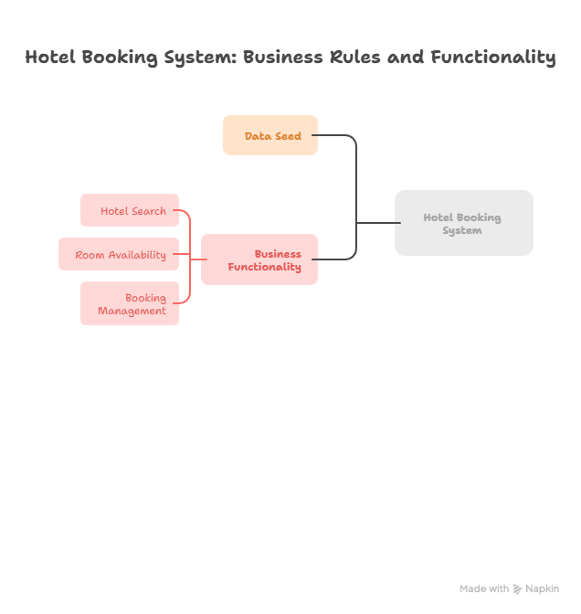
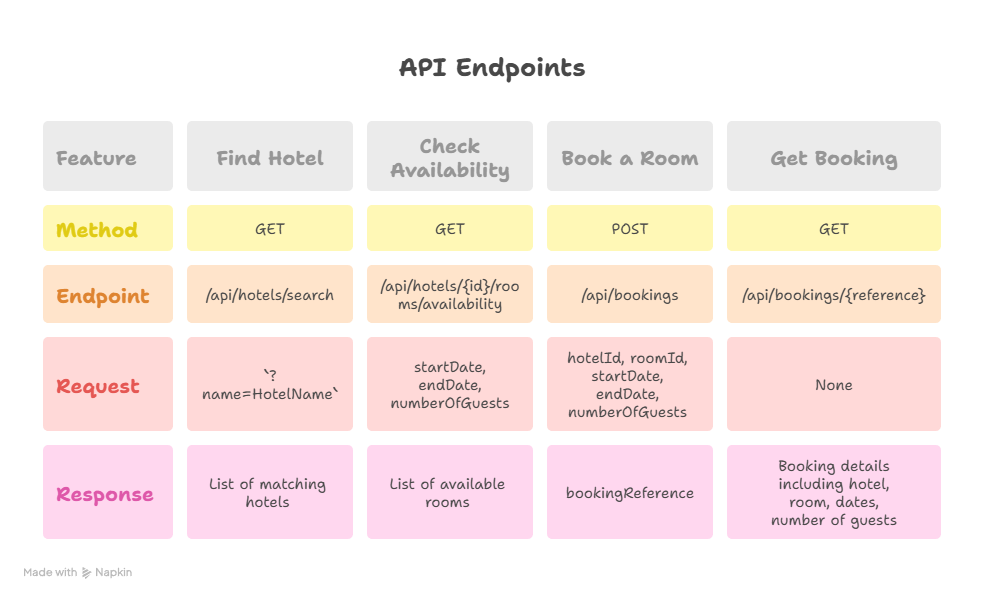

# Hotel Room Booking System

A .NET 8 Web API for managing hotel room bookings, built with Entity Framework Core and SQLite.

## Live Demo
- **Swagger UI:** http://hotelroombooking20250912183244-aqd4aycnced6fecs.ukwest-01.azurewebsites.net/swagger/index.html

- **Loom Video while coding:** https://loom.com/share/folder/a0fbb878f52e45b9bfae3afebaf892f5
  
## Flow Diagrams

## Features
- Manage hotels, rooms, and bookings
- Check room availability
- Create and manage bookings
- RESTful API with Swagger documentation

## Tech Stack
- **Backend:** .NET 8, ASP.NET Core Web API
- **Database:** SQLite with Entity Framework Core
- **Testing:** xUnit
- **Deployment:** Azure App Service (Free Tier)

## Local Setup
1. Clone the repo: `git clone https://github.com/Mahesh7667/HotelRoomBookingSystem.git`
2. Navigate to project: `cd HotelRoomBookingSystem`
3. Restore packages: `dotnet restore`
4. Run migrations: `dotnet ef database update`
5. Run the app: `dotnet run`
6. Access Swagger at `https://localhost:5001/swagger` (or HTTP port)

## API Endpoints
- **Hotels:**
  - `GET /api/hotels?name={name}` - Find hotel by name
  - `GET /api/hotels/all` - Get all hotels with rooms
- **Rooms:**
  - `GET /api/rooms/available?checkIn={date}&checkOut={date}&guests={number}` - Find available rooms
- **Bookings:**
  - `POST /api/bookings` - Create a new booking
  - `GET /api/bookings/{reference}` - Get booking by reference
- **Data:**
  - `POST /api/data/seed` - Seed database with test data
  - `POST /api/data/reset` - Reset all data

## Deployment to Azure
1. Use Azure CLI or VSCode extension.
2. Create App Service (F1 Free Tier).
3. Deploy via `dotnet publish` and zip upload.
4. Database persists in App Service storage.

## Testing
Run tests: `dotnet test`

## AI Assistants Used

- **Copilot :** Autocompletion, Unit Tests Boilerplate
- **Napkin.ai:** FlowCharts
